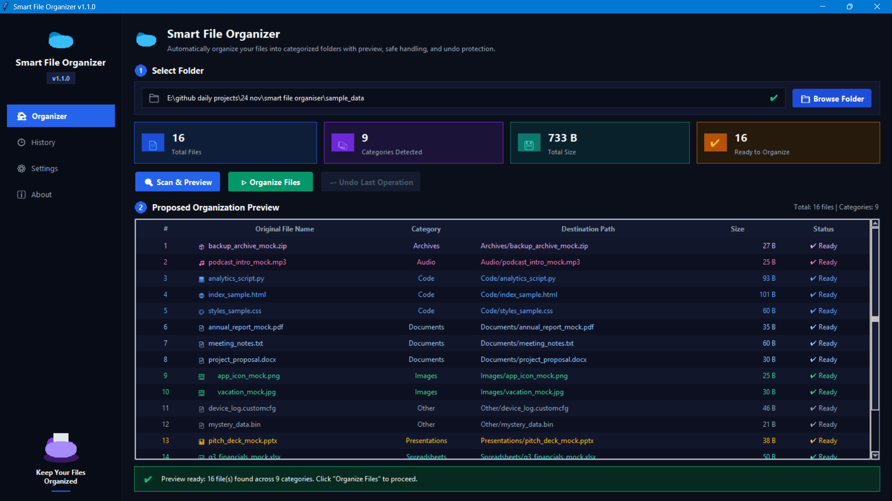
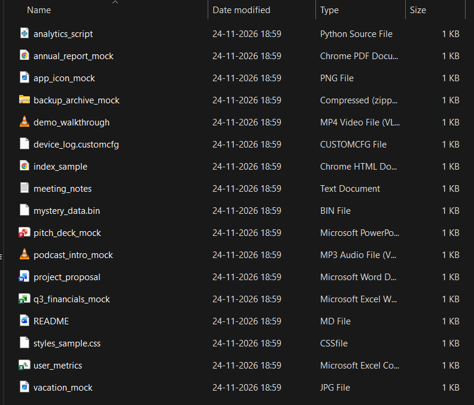
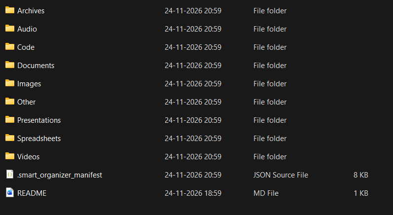

# Smart File Organizer

A lightweight, dependable desktop application designed to categorize cluttered files into clean folders by extension without risking data loss, unintended overwrites, or accidental file corruption.

Built entirely using Python's standard library with a responsive **Tkinter** graphical interface.

---

## Overview

Cluttered directories (like Downloads or unsorted project drives) make locating critical assets tedious. **Smart File Organizer** inspects target folders, categorizes loose files according to predefined extensions (such as Documents, Images, Spreadsheets, Code, Audio, and Video), offers an interactive dry-run preview, and executes moves safely with collision detection and full undo support.

---

## Key Features

- **Intuitive GUI**: Built with Tkinter and themed ttk widgets for a clean, accessible layout.
- **Dry-Run Preview**: Inspect candidate files and target folder destinations prior to making any filesystem changes.
- **Non-Destructive File Movement**:
  - Automatically derives unique filenames (`report_1.pdf`, `report_2.pdf`) when duplicates exist.
  - Never overwrites or deletes existing user documents.
- **One-Click Undo**:
  - Restores moved files back to their exact original locations using a local `.smart_organizer_manifest.json`.
  - Skips files that were edited after organization or where the original path has since become reoccupied.
  - Automatically prunes empty category directories left after a full rollback.
- **Safety Boundaries**:
  - Protects filesystem roots (`C:\`, `E:\`, `/`).
  - Guards operating system folders (`Windows`, `System32`, `Program Files`, `ProgramData`).
  - Protects direct user profile roots (`C:\Users\<user>`).
  - Ignores nested subdirectories (non-recursive in v1).
  - Skips directory and file symlinks.
  - Protects the application's own source code and configuration files.
- **Responsive Architecture**: Runs filesystem scans and organization routines inside background worker threads, keeping the UI fluid and interactive.
- **Dual Mode**: Can be operated via graphical interface or via command-line flags (`--preview`, `--organize`, `--undo`).

---

## Category Mappings

| Category | Extensions |
| :--- | :--- |
| **Images** | `.jpg`, `.jpeg`, `.png`, `.gif`, `.webp`, `.bmp` |
| **Documents** | `.pdf`, `.doc`, `.docx`, `.txt`, `.rtf` |
| **Spreadsheets** | `.csv`, `.xls`, `.xlsx` |
| **Presentations** | `.ppt`, `.pptx` |
| **Videos** | `.mp4`, `.mkv`, `.avi`, `.mov` |
| **Audio** | `.mp3`, `.wav`, `.flac` |
| **Archives** | `.zip`, `.rar`, `.7z` |
| **Code** | `.py`, `.js`, `.html`, `.css`, `.java`, `.cpp` |
| **Other** | Any unrecognized file format or extensionless file |

*Note: Extension evaluation is strictly case-insensitive.*

---

## Technology Stack

- **Python**: 3.11+
- **GUI Toolkit**: Tkinter / ttk
- **Filesystem Utilities**: `pathlib`, `shutil`, `os`
- **Concurrency**: `threading`, `queue`
- **Data Serialization**: `json`
- **Testing**: `unittest`
- **Logging**: `logging`

Zero third-party package dependencies required.

---

## Installation & Setup

Ensure Python 3.11 or newer is installed on your computer:

```bash
python --version
```

Clone or download the project into your local directory:

```bash
git clone https://github.com/<your-username>/smart-file-organizer.git
cd "smart file organiser"
```

No external virtual environment or `pip install` commands are needed.

---

## Running the Application

### 1. Graphical Interface (Standard)

Launch the desktop UI:

```bash
python main.py
```

Optional: launch with an initial folder already targeted:

```bash
python main.py "C:\Users\<Username>\Downloads"
```

### 2. Command-Line Options (Headless / Automation)

Perform a dry-run preview:
```bash
python main.py --preview "sample_data"
```

Organize files directly from the command prompt:
```bash
python main.py --organize "sample_data"
```

Undo an earlier organization:
```bash
python main.py --undo "sample_data"
```

Check version or help:
```bash
python main.py --help
python main.py --version
```

---

## Project Structure

```text
smart-file-organizer/
│
├── main.py              # Application launch point and CLI interface
├── organizer.py         # File categorization, preview engine, and undo system
├── gui.py               # Tkinter desktop interface with threaded task worker
├── config.py            # Extensions, protected system directories, and constants
│
├── tests/
│   └── test_organizer.py # Comprehensive automated test suite
│
├── sample_data/         # Demonstration files for safe manual experimentation
│   └── README.md
│
├── .gitignore           # Ignores bytecode, logs, manifests, and system files
└── README.md            # Project documentation
```

---

## Graphical User Interface Overview

The v1.1.0 desktop interface features a modern dark navy dashboard inspired by contemporary creative developer tools, built purely with Python's standard library.

```text
+-----------------------------------------------------------------------------------------------------+
| [Sidebar ~210px]               | [Main Content Area (Dark Navy #0B0F19)]                           |
| 📁 Smart File Organizer v1.1.0 | 📁 Smart File Organizer                                            |
|                                |    Subtitle: Automatically organize your files with preview...     |
| [🏠 Organizer] (Active)        |-------------------------------------------------------------------|
| [🕒 History  ] (Functional)    | [1] Select Folder                                                  |
| [⚙️ Settings ] (Functional)    |  [ 📁 E:\...\sample_data                       ✔ ] [ Browse Folder ]|
| [ℹ️ About    ] (Functional)    |-------------------------------------------------------------------|
|                                | [ Total Files ] [ Categories ] [ Total Size ] [ Ready to Organize]|
|                                |      16               9            733 B               16          |
|                                |-------------------------------------------------------------------|
|                                | [ 🔍 Scan & Preview ]  [ ▷ Organize Files ]  [ ↩ Undo ]           |
|                                |-------------------------------------------------------------------|
|                                | [2] Proposed Organization Preview           Total: 16 | Cats: 9   |
|                                |  # | Original File Name | Category | Destination | Size | Status  |
|                                |----+--------------------+----------+-------------+------+---------|
|                                |  1 | 📦 backup.zip      | Archives | Archives/.. | 27 B | ✔ Ready |
|                                |  2 | 🎵 podcast.mp3     | Audio    | Audio/..    | 25 B | ✔ Ready |
|                                |  3 | 💻 script.py       | Code     | Code/..     | 93 B | ✔ Ready |
| [Keep Your Files Organized]    |  4 | 📄 report.pdf      |Documents | Documents/..| 35 B | ✔ Ready |
| [Glowing folder graphic]       |-------------------------------------------------------------------|
|                                | [✔] Status: Preview ready: 16 file(s) found across 9 categories.  |
+-----------------------------------------------------------------------------------------------------+
```

---

## Application Screenshots

### Main Application Dashboard


### Before Organization


### After Organization


---

## Automated Testing

Execute the test suite using Python's built-in `unittest` runner:

```bash
python -m unittest discover tests -v
```

### Verified Test Cases:
1. Accurate file categorization across all extension groups.
2. Case-insensitive handling (`.JPG`, `.pDf`, `.Py`).
3. Suffix collision prevention (`file_1.ext`, `file_2.ext`).
4. Complete immutability during preview runs.
5. Correct file placement into on-demand category folders.
6. Fallback grouping into `Other` for unknown formats.
7. Total restoration during undo runs.
8. Preservation of pre-existing conflict files during undo.
9. Safeguards for files modified between organize and undo.
10. Rejection of root drives and operating system folders.
11. Preserving internal subdirectories and symlink safety.
12. Application workspace self-protection.

---

## Safety Guarantees

1. **No Overwrites**: Files destined for existing names are suffixed with numerical counters.
2. **Read-Only Previews**: Scanning only reads metadata; nothing is written or moved until confirmed.
3. **Modified-File Guard**: If a user modifies an organized file, the undo process detects the size discrepancy and skips it to prevent accidental reversion.
4. **Symlink Isolation**: Symlinks are never traversed or relocated.
5. **System Path Refusal**: Prevents accidental operation against Windows root or system directories.

---

## Known Limitations

- **Top-Level Processing Only (v1)**: Subdirectories within the selected folder are left untouched to prevent modifying structured child projects.
- **Filename-Based Collision Handling**: Renaming handles duplicate destination names (`report_1.pdf`), but does not calculate SHA-256 binary checksums.
- **Process Locks**: If a file is currently open in an application that takes an exclusive lock (e.g., active video editor or database), the operating system rejects the move; Smart File Organizer safely catches the exception, skips the file, and reports it without interrupting the remaining batch.
- **License Status**: The repository is prepared for an MIT open-source license, which can be applied upon project owner authorization.

---

## Roadmap & Future Enhancements

- Customizable category mappings and extension rules via UI preferences.
- Optional recursive subfolder sorting with depth toggles.
- Date-based grouping filters (e.g. `Year/Month`).
- Duplicate content hashing (SHA-256) for identifying identical duplicate files.
